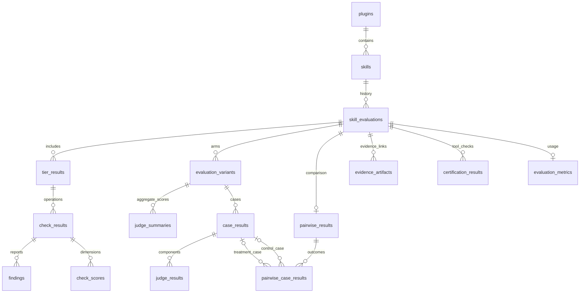

# Reports and persistence

Every run writes local evidence. Select publication explicitly with
`--persist postgres,s3,compass` or `ABEVAL_PERSIST`; credentials alone do not
enable uploads. Each destination is attempted independently, including after
failed checks. See the [CLI reference](cli.md#persistence-opt-in) for configuration.

## Destinations

| Destination | Configuration | Stored data |
|---|---|---|
| PostgreSQL | `ABEVAL_DATABASE_URL` | Plugin/skill identities, tier/check results, both evaluation arms, case/judge scores, pairwise outcomes, findings, artifact references, and tool metrics. |
| S3 / MinIO | `ABEVAL_S3_ENDPOINT`, `ABEVAL_S3_BUCKET`, `ABEVAL_S3_ACCESS_KEY`, `ABEVAL_S3_SECRET_KEY` | Report files under `<plugin>/<skill>/<run-id>/reports/` and the manifest at `<plugin>/<skill>/<run-id>/run.json`. |
| Compass | `gate_policy.push_facts` in metadata; `ABEVAL_COMPASS_TOKEN` | Selected gate and certification facts. |

The base CLI installation writes local reports. Install the `storage` extra for
PostgreSQL/S3. Supply credentials through environment variables locally or
Secret-backed environment variables in Kubernetes.

## Reports

The run directory contains `run.json` and a `reports/` directory:

| Artifact | Contents |
|---|---|
| `run.json` | Configuration without credentials, source identity, step results, artifact paths, and publication outcomes. |
| `scorecard.json`, `scorecard.md` | Gate results and policy recommendation. |
| `certification.json` | Certification levels and individual checks. |
| `report.html` | High-level skill report with category scores, findings, and case-level evaluation detail. |
| `score-overview.svg`, `evidence.html` | Score graphic and browsable index of the run's report artifacts. |
| `report.json`, `report.md` | Normalized machine-readable and Markdown AEH results when evaluation ran. |
| Scanner JSON/SARIF and logs | Available static evidence and scanner errors. |
| `_ai_review.json`, `skill-review.json` | Selected advisory reviews. |

Source copies and kubeconfigs are excluded from publication. Execution status,
policy verdict, and publication status are separate. Selected publication
failures fail the command by default; `--no-persistence-required` makes those
failures advisory.

## Retry publication

```sh
abeval publish --run-dir .abeval/runs/<run-id> --persist postgres,s3
```

Supply credentials again through the current environment. This command reuses
saved evidence; it does not repeat scans, reviews, or trials. PostgreSQL snapshots
are transactional and idempotent by run ID. S3 uses stable object keys.
A successful retry can still return a failure exit code from earlier run evidence.
Schema v2 requires a fresh database. Initialization rejects the old tables and
never drops or migrates them. Set `ABEVAL_DATABASE_URL` to the fresh destination
before publishing with CLI 0.5.0. Existing database consumers must use the new
schema/views described below.

## PostgreSQL evidence schema v2

PostgreSQL stores queryable results emitted by the pipeline and evaluation tools.
When S3 publication is selected, original reports remain there; `evidence_artifacts` records each uploaded object's
URI, endpoint, SHA-256, media type, and byte size. Report bodies are not duplicated
as whole-report JSON columns in PostgreSQL. Selected tool details, policy,
score ranges, dimensions, per-phase metrics, and comparison reasoning remain in
JSONB alongside indexed result identities and numeric scores.

Every evaluation records its source commit SHA. PostgreSQL publication requires
`--revision` / `ABEVAL_REVISION` to contain a full 40- or 64-character hexadecimal
commit SHA. Plugin identity is inferred from `<plugin>/skills/<skill>`, or supplied
through `metadata.yaml`'s `plugin_name`, `--plugin-name`, or `ABEVAL_PLUGIN_NAME` for
standalone skills. Conflicting plugin identities are rejected.

Supply the evaluated content image with `--built-image-ref` or
`ABEVAL_BUILT_IMAGE_REF`, using `repository@sha256:<digest>`. The Konflux task
passes its built component `image-url` and `image-digest` into this field for every
skill in the batch. The field is nullable when no content image was built, such
as an independent PR evaluation. `trial_image_ref` records the separate trial
runtime image. Image references are not inferred from mutable tags.



`skill_evaluations` is the stable parent, including partial or failed executions
that have no AEH report. Retrying publication replaces the child projection in a
single transaction while retaining the evaluation ID and original execution time.
An existing run ID cannot be assigned to another skill, commit, or built image.

Tier 1 contains structure, security, quality and optional skill-review operations.
Tier 2 contains submission validation, optional submission review, and AEH.
Skipped and missing requested operations have unavailable results; missing scores
are null. No zero score is invented for an unavailable judge or failed operation.

Pairwise evaluations contain `control` and `treatment` variants. Each keeps its
own aggregate reward, per-case reward, and raw/normalized judge values. Judge
ranges are retained separately for each arm. Boolean checks can gate the case
reward to zero; numeric judges are normalized and averaged by the existing AEH
scoring implementation. The scoring method and declared ranges are recorded with
the variant. Pairwise case outcomes and their aggregate win rate are separate
signals: treatment wins / (treatment wins + control wins + ties + errors).
Comparison rows link back to both arm case rows when those case results exist.

Findings belong to the check that emitted them. Severity counts include critical,
high, medium, low and info, with zero counts for checks that emitted no findings.
A case identifier is retained when provided by the tool; skill-wide scanner
findings are not assigned to arbitrary AEH cases.

### Querying plugins and drilling into results

The views derive results from each known skill's latest evaluation, ordered by
execution start time and run ID as a deterministic tie-breaker. Publication time
never determines which result is latest. Failures and partial runs remain visible;
a Tier 1-only latest run does not inherit Tier 2 scores from an older commit.
Only skills that have been published to this database are included in its catalog.

| View | Result |
|---|---|
| `plugin_results` | Counts of known/evaluated skills, emitted recommendations, errors and findings by severity, using each skill's latest evaluation. |
| `skill_compass_results` | Historical evaluation rows with an `is_latest` flag and the six values named after their exact Compass check IDs. |
| `latest_skill_scorecards` | One readable row per evaluated skill: quality/security scan scores, submission review, behavior score, sample sizes, status, and severity counts. |
| `latest_skill_results` | Detailed one-row-per-skill result: provenance, tier status/verdicts, treatment/control reward, pairwise outcomes, and findings by severity. |
| `latest_skill_judge_scores` | Latest aggregate judge scores per skill and arm, including tool-emitted details. |
| `check_finding_counts` | Counts of every severity per check, for all evaluations. |
| `latest_skill_evaluations` | Latest parent evaluation for each skill, including failed and partial runs. |

```sql
-- Plugin overview and each skill's latest scores.
SELECT * FROM plugin_results WHERE plugin_name = 'rh-sre';
SELECT * FROM latest_skill_scorecards WHERE plugin_name = 'rh-sre';
SELECT * FROM latest_skill_results WHERE plugin_name = 'rh-sre';
SELECT * FROM latest_skill_judge_scores WHERE plugin_name = 'rh-sre';

-- Read the six Compass-facing values for current or historical evaluations.
SELECT * FROM skill_compass_results
WHERE plugin_name = 'rh-sre' AND is_latest;

SELECT * FROM skill_compass_results
WHERE plugin_name = 'rh-sre' AND skill_name = 'cve-impact'
ORDER BY started_at DESC, run_id DESC;

-- Inspect security and quality findings by check within one evaluation.
SELECT c.name, c.status, c.score, f.*
FROM tier_results t
JOIN check_results c ON c.tier_result_id = t.id
JOIN check_finding_counts f ON f.check_id = c.id
WHERE t.evaluation_id = :evaluation_id;

-- Drill into each case and its score components for both arms.
SELECT v.name AS arm, c.case_key, c.reward, j.name AS judge,
       j.raw_value, j.normalized_score, j.score_range, j.error, j.details
FROM evaluation_variants v
JOIN case_results c ON c.variant_id = v.id
JOIN judge_results j ON j.case_result_id = c.id
WHERE v.evaluation_id = :evaluation_id;

SELECT * FROM evidence_artifacts WHERE evaluation_id = :evaluation_id;
```

`latest_skill_scorecards` keeps separate score meanings: quality scan,
submission review, security scan, absolute treatment reward, and pairwise win
rate. Scanner scores use `severity_penalty_v1`: start at 1.0 and subtract 1.0
per critical, 0.30 per high, 0.10 per medium, and 0.02 per low finding, clamped
to [0, 1]. Informational findings do not reduce the score. A failed or
incomplete scan has a null score. The finding counts and the check's `details`
include the calculation breakdown. These weights are policy values, not a
claim that severity can be measured objectively.

`skill_compass_results` exposes those values using the exact quoted Compass
check IDs: `valid-skill-structure`, `basic-security-validation`,
`content-quality-review`, `advanced-security-validation`,
`instruction-quality`, and `enterprise-behavioral-evaluation`. Basic and
advanced security intentionally contain the same scan score; content and
instruction quality intentionally contain the same quality score. Numeric
values are on the Compass 0–100 scale and remain null when unavailable.
Structure matches the published fact value and is false when validation failed
or did not complete. Use `is_latest` to distinguish the current evaluation from
history; failed and partial latest evaluations do not inherit older values.

Behavior score is the treatment's absolute mean reward on [0, 1]. For the
standardized CVE submissions it is the configured weighted mean of
`task_accuracy` (0.65), `workflow_contract` (0.30), and
`report_completeness` (0.05). The same weights are used by both CVE skills,
both pairwise arms, and single-run configs. The configured weights and score
ranges are retained in each variant's `scoring` data. Pairwise win rate is a
separate relative comparison and should always be read with its case count.

The optional `gate_policy.gates.evaluation.minimum_reward` sets the absolute
treatment reward floor in pairwise mode; `threshold` remains the separate
pairwise win-rate threshold. A pairwise result passes only when both configured
conditions pass. The recommendation and each underlying score remain separate
outputs; there is no cross-aspect grand total.

### Publication ordering and retries

Selected destinations are attempted independently in the order Compass, S3,
PostgreSQL. Compass updates the report before upload; the DB receives the exact
object list returned by S3. A partial S3 failure still records the confirmed
uploaded objects in PostgreSQL. Publication outcomes are recorded in `run.json`;
there is no publication destination or status table in PostgreSQL.

A PostgreSQL-only retry reuses S3 references saved in the local `run.json`.
Destination selection and secrets are supplied through the current invocation;
unselected earlier publication outcomes remain in the manifest. S3's uploaded
manifest reflects publication state at S3 upload time, before the subsequent
PostgreSQL transaction. S3 object URIs are durable references; accessing private
objects still requires the bucket's existing authentication mechanism.

## Compass facts

With `persist=compass` and `gate_policy.push_facts` configured, the workflow
publishes six explicit skill facts in addition to the existing enabled gate
facts and certification level/summary facts. Each reference is
`<fact_ref_prefix><check-id>`. For the RH SRE deployment the prefix is
`ai5-marketplace:default/`; the entity reference comes from submission metadata.

| Check ID | `data.value` source | Type | Suggested Compass rule |
|---|---|---|---|
| `valid-skill-structure` | Dedicated structure validation outcome | Boolean | `true` |
| `basic-security-validation` | `security_scan_score_100` | Number, 0–100 | `>= 60` |
| `content-quality-review` | `quality_scan_score_100` | Number, 0–100 | `>= 60` |
| `advanced-security-validation` | Same `security_scan_score_100` | Number, 0–100 | `>= 90` |
| `instruction-quality` | Same `quality_scan_score_100` | Number, 0–100 | `>= 70` |
| `enterprise-behavioral-evaluation` | `behavior_score_100` | Number, 0–100 | `>= 50` |

These values use the same evidence and one-decimal rounding as the
`latest_skill_scorecards` database view; publishing does not query the database
and also works with Compass as the only persistence destination. Behavior uses
`report.summary.treatment.mean_reward * 100`, including pairwise runs, rather
than the evaluation gate's potentially different pairwise win rate. Instruction
quality has no separate evaluator today; its fact names the quality scan as its
source and Compass applies its own threshold. Scanner scores are independent of
the scanner gate's warning/blocking verdict.

Fact submissions explicitly set `cache: true` so Compass retains the values for
Fact Explorer and later check execution. A successful uncached submission can
trigger a check without leaving a retrievable fact for a subsequent execution.

Every fact includes `available`, `source`, `value_type`, `run_id`,
`source_revision`, and `evaluated_at`. Missing numeric evidence publishes
`value: null, available: false`, replacing stale scores; it is never converted
to a passing zero or silently omitted. Structure always publishes a boolean:
`false` for a failed or unavailable validation, with `available: false` when it
did not complete. Structure retains its earlier diagnostic fields, including
`passed`, for existing consumers.

The existing `ai-skill-quality` track keeps its six check IDs. Update each
check's fact rule to read `$.value`, require `$.available == true`, and apply
the boolean or numeric comparison shown above. Ready-to-apply definitions are
in [compass-skill-checks.yaml](examples/compass-skill-checks.yaml). Thresholds
belong to Compass check rules, not the publisher. Adjust them there without
changing evaluation scores. Changing check rules affects every entity using
those checks; entities need facts from the updated evaluator on their next run.

Gate, certification, and skill fact publication outcomes are recorded separately
in `scorecard.json` as `fact_push_results`, `certification_fact_push_results`,
and `skill_fact_push_results`. Any attempted fact publication failure fails the
selected publication destination when persistence is required. These Compass
thresholds are separate from the evaluator's internal certification policy.

Compass verifies TLS certificates and hostnames by default using Python's trust
store (including `SSL_CERT_FILE`). For environments that explicitly opt out,
`--insecure-ssl` / `ABEVAL_INSECURE_SSL=true` also disables verification for all
Compass gate, certification, summary, and structure fact requests. This is a
runtime setting, not submission metadata, and logs a warning when used. It
removes server authentication, including protection for the bearer token; it
does not affect Kubernetes API TLS or S3's separate verification setting.

## PostgreSQL TLS routes

Set `ABEVAL_DATABASE_TLS_ROUTE_HOST` (or `--database-tls-route-host` for a new
workflow) when PostgreSQL is exposed through a TLS passthrough route on port 443.
The database URL must use a loopback hostname. The CLI opens an ephemeral local
relay for the transaction and verifies the route certificate using the default
trust store or `SSL_CERT_FILE`. `DB_TLS_ROUTE_HOST` is an environment alias.
Direct database URLs do not start a relay.

## CI evidence

OCI archives and attachments are produced by the consuming Konflux task using
its existing task-runner tooling. They are independent of CLI persistence;
registry credentials and attachment status remain owned by the pipeline.
